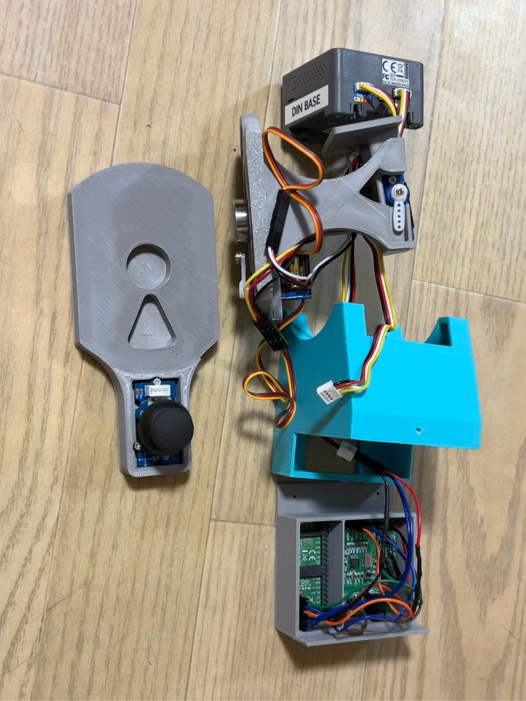
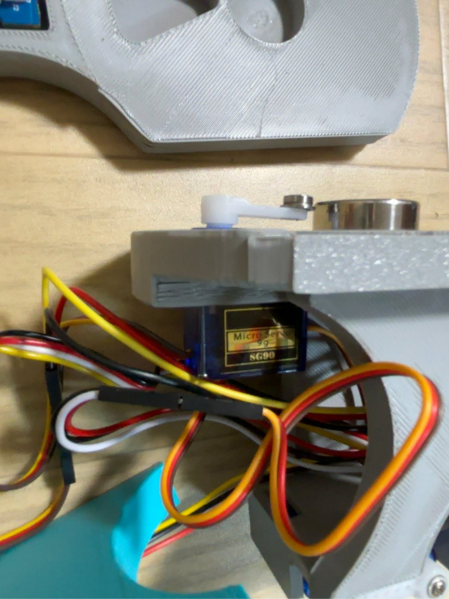
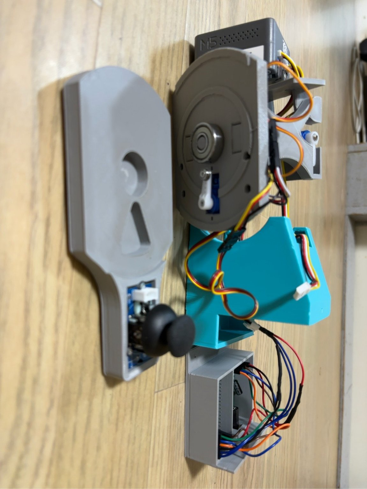
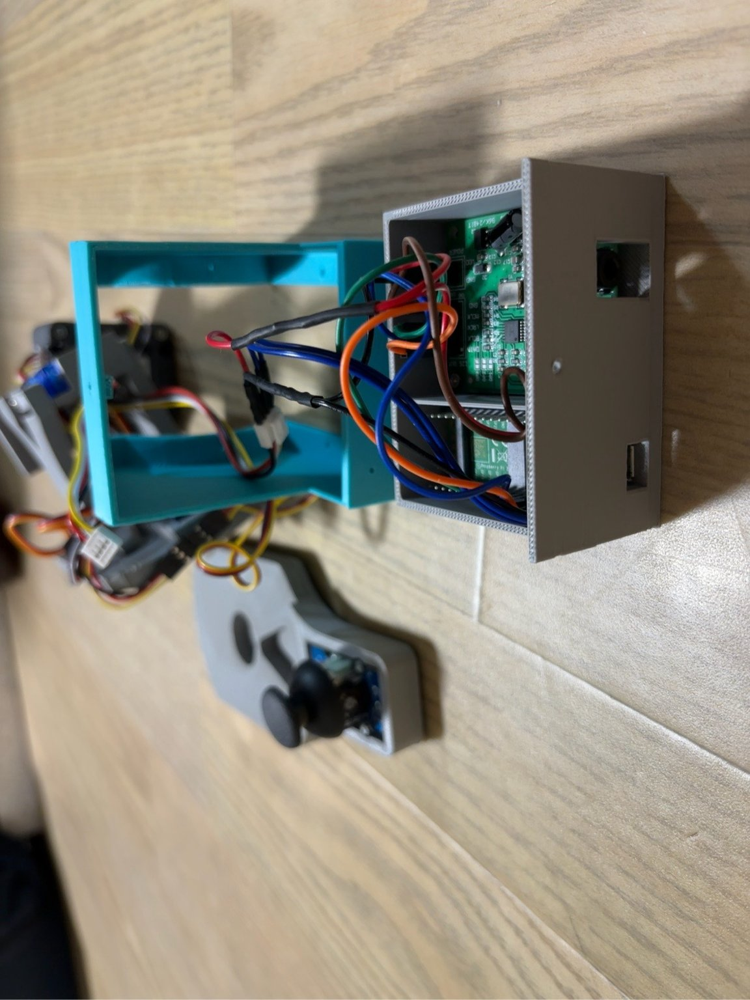

[Japanese original / 日本語版](karipom_manual.md)

{width=4.2in}

Thank you for welcoming KariPom into your home. This user manual is designed to help even those who are new to electronics projects enjoy KariPom safely. Please read it before use and keep it for future reference.

```{=openxml}
<w:p><w:r><w:br w:type="page"/></w:r></w:p>
```

# Chapter 1 — Introduction

## 1.1 About This Manual

This is the user manual for KariPom, a small animatronic robot that talks, moves, and listens.

Unlike an off-the-shelf consumer appliance, KariPom is a DIY electronics project built around the **M5Stack CoreS3**, a compact computer that serves as its brain. However, you do not need advanced technical knowledge to get started. By following this manual, even someone without programming experience can power it on, connect it to Wi-Fi, and control it from a smartphone or computer.

This manual is intended for readers such as:

- People who have never heard of Arduino or M5Stack.
- People with little or no experience in electronics projects.
- People who are interested in AI services such as ChatGPT but feel uncertain about working with hardware.

Technical terms are explained as they appear. A glossary is also provided in **Chapter 23** for terms you may want to look up later.

KariPom is an ongoing project published on GitHub and continues to receive updates. If the behavior of your unit differs from the descriptions in this manual, refer to the latest WebUI display (see the revision history in Chapter 22).

**The following five types of materials are available on GitHub:**

| Published material | Description |
|---|---|
| This KariPom User Manual | A beginner-friendly guide focused on what KariPom can do, how to enjoy it, and where to begin. |
| Karipom Ear Design & Build Manual | An advanced guide covering wiring, circuits, and assembly for adding a PCM1808-based I2S ADC board and Pico 2 H to the CoreS3 so you can enjoy BBX without a PC. |
| KariPom main software (Arduino firmware) | Control software that runs on the KariPom unit (CoreS3). |
| PC applications (Companion and Desktop) | PC-side programs, including KariPom Companion and KariPom Desktop (see Chapter 2). |
| 3D-printing files | Design files for printing KariPom's body and enclosure. |

Detailed electronics, circuit design, and wiring diagrams are intentionally not covered here. They are collected in the **Karipom Ear Design & Build Manual**. This manual refers readers to that separate guide when those details are needed, rather than duplicating the same information in both documents.

💡 This manual is designed both for human readers and for use alongside AI assistants such as ChatGPT or Claude. For example, you can provide the manual together with source code and an error message, then ask the AI what to try next based on the documented instructions and the error you are seeing.

## 1.2 How to Read This Manual

If this is your first time using KariPom, read these chapters in order: **Chapter 4, “Safety Precautions” → Chapter 7, “Initial Setup” → Chapter 8, “Wi-Fi Setup” → Chapter 9, “Using the WebUI.”** Once you have completed these four chapters, you should be able to perform KariPom's basic operations.

After that, you can explore the chapters for whichever features interest you: facial expressions, muttering, microphone functions, Visualizer, Lighting, and more.

If you encounter a problem, see **Chapter 20, “Troubleshooting,”** and **Chapter 21, “FAQ.”**

## 1.3 Symbols Used in This Manual

| Symbol | Meaning |
|---|---|
| ⚠️ **Warning** | Important precautions that, if ignored, could lead to injury or equipment damage. |
| ❗ **Caution** | Precautions that, if ignored, could cause KariPom to malfunction or shorten its service life. |
| 💡 **Tip** | Helpful information worth knowing. |

```{=openxml}
<w:p><w:r><w:br w:type="page"/></w:r></w:p>
```

# Chapter 2 — What Is KariPom?

## 2.1 KariPom Profile

KariPom is a palm-sized animatronic robot designed to sit on a desk and be enjoyed.

“Animatronics” refers to **mechanical figures that use motors to move in lifelike ways**, such as characters at theme parks or practical effects used in films. KariPom brings that kind of technology down to a compact, home-friendly scale.

[Figure: Front view of the pink KariPom and a sequence showing the head in motion]

KariPom is built around the **M5Stack CoreS3**, a compact computer that integrates a display, speaker, microphone, camera, and Wi-Fi. Its head moves up/down and left/right, its face appears on the display, and its speaker plays spoken lines (Mutter).

Because KariPom's enclosure is 3D-printed, you are free to choose its color. The two units shown in this manual—the **pink unit** and the **Tiffany-blue unit**—are examples built by the creator. Their internal functions are the same.

From the WebUI, the face shown on the display can be switched among three Face Modes: “KariPom,” “Miss KariPom,” and “Face Gallery” (Chapter 10). KariPom and Miss KariPom have no major difference in appearance or function; they are simply two appearances you can choose according to your mood. With Face Gallery, you can keep a favorite image displayed, or hide the face entirely and enjoy only the Lighting and Visualizer effects across the full screen.

## 2.2 Project History — How KariPom Came to Be

KariPom began with a simple idea: to build my own version of **Stack-chan**, a popular character project published for M5Stack.

As development continued, another goal emerged: to make it look as though KariPom were having a natural conversation with ChatGPT rather than merely displaying facial expressions. Instead of using dedicated speech-recognition or text-to-speech APIs, the project began by exploring whether a simple mechanism—**moving the mouth in response to audio volume**—could create a convincing conversational effect. This became the origin of KariPom's lip-sync feature.

Then, while tuning lip-sync accuracy, something unexpected happened. When music was played, the speech-detection state fluctuated rapidly, causing KariPom to move its head and mouth as if it were enthusiastically keeping the beat. Normally this would have been treated as detection instability and corrected as a defect. But the motion was so entertaining that the project changed direction: instead of eliminating it, the behavior was developed into a new way to enjoy KariPom. This accidental discovery greatly expanded the project's direction.

Inspired by the term “Beat Box,” this manual calls KariPom's distinctive world of moving energetically with music **BBX**. BBX does not refer only to lip-sync. It is the overall KariPom experience created by combining mouth and head movement in response to sound with **Karipom Ear**, which listens to audio; **Visualizer**, which fills the display with sound-driven graphics; and **Lighting**, which provides animated background effects.

This discovery led to the development of three features in succession: **Karipom Ear** (Chapter 12), **Visualizer** (Chapter 13), and **Lighting** (Chapter 14). KariPom consequently evolved from a simple lip-sync robot into a **BBX project** designed to be enjoyed together with sound.

Today, even people who do not own a physical CoreS3 can experience this world through **KariPom Desktop** (2.3), which runs entirely on a PC. An expanded configuration that adds a PCM1808-based I2S ADC board and a Raspberry Pi Pico 2 H to the CoreS3 (Chapter 12) also makes it possible to enjoy BBX without a PC. Schematics, circuit diagrams, and assembly instructions for this expansion are published on GitHub in the **Karipom Ear Design & Build Manual**. KariPom, including this expanded configuration, remains an actively evolving project.

💡 KariPom is an ongoing project published on GitHub. New features not described in this manual may be added in the future.

## 2.3 KariPom Desktop — Enjoy KariPom Using Only a PC

**KariPom Desktop** is a sister project published on GitHub. It does not use a CoreS3; instead, it is a **standalone version that isolates the lip-sync experience at the core of BBX**. It is not a “demo version” that merely substitutes for part of what the CoreS3 can do. Rather, it is an independent application in which the lip-sync experience itself is completed entirely on a PC. KariPom Desktop also lets you enjoy BBX on-screen effects, including Visualizer and Lighting, on your PC.

- **Supported operating systems** — Windows, macOS, and Linux.
- **No dedicated hardware required** — It runs entirely in Python and does not require a CoreS3, Arduino, or sensors.
- **Looks as though KariPom is talking with AI** — When launched, it automatically opens ChatGPT in a browser. During a voice conversation, KariPom moves its mouth in response to the voice. When nobody is speaking, blinking and nose movements help keep the character looking alive.
- **Accessible to beginners** — Setup is designed to be performed by giving the distributed Python file to an AI assistant such as ChatGPT and asking it to guide you according to your PC environment. Rather than stopping once the application runs, we recommend asking the AI to create a launcher that lets you start it with a double-click next time. See the setup guide in the KariPom Desktop repository for details.

KariPom Desktop GitHub repository: `https://github.com/kariagepompadour/KariPom-Desktop`

💡 If you are unsure whether to use KariPom Companion or KariPom Desktop, see the comparison diagram in Chapter 15 (15.1).

## 2.4 Ways to Enjoy KariPom

There are four main ways to enjoy KariPom. All of them share the same concept: making KariPom appear alive in response to sound.

1. **Keep it nearby and watch it** — Simply leave it powered on and it will occasionally move its head (idle motion) or mutter something at random intervals.
2. **Control it from a smartphone or computer** — Open KariPom's settings screen (WebUI) over Wi-Fi to change its expression, make it speak, or move it.
3. **Make it react to sound (the BBX experience)** — With the **Karipom Ear** audio-input feature, you can switch among three sources—built-in microphone, PC audio (Wi-Fi), and LINE IN—and make the mouth move in response to sound. With **Visualizer (Chapter 13)**, you can also enjoy the sound itself as full-screen light and graphic effects.
4. **Enjoy visual effects on the display** — **Lighting (Chapter 14)** provides effects independent of sound, including disco-style lighting and retro-game-inspired screen savers.

Even without a physical CoreS3, parts of items 3 and 4 can be experienced with KariPom Desktop (2.3). The full CoreS3 feature set can be enjoyed in combination with KariPom Companion (Chapters 9 and 15). KariPom is deliberately not designed to embed an AI API and converse autonomously, so it does not require an API key or usage-based AI API fees. Instead, KariPom reacts to conversations and audio output from voice AI services such as ChatGPT that you already use on a PC or other device.

## 2.5 Where Should I Start? — Three Configurations

The following three configurations are presented so first-time users can quickly see where to begin. Advanced technical knowledge is not required.

| Configuration | What you need | What you can experience |
|---|---|---|
| **1. KariPom Desktop** | PC only (no CoreS3 required) | Standalone version for enjoying BBX using only a PC (2.3) |
| **2. CoreS3 + KariPom Companion** | KariPom unit + PC (optional) | Standard configuration for enjoying KariPom's main features, including the WebUI and BBX (Chapters 9 and 15) |
| **3. CoreS3 + KariPom Companion + Karipom Ear (PCM1808 + Pico 2 H)** | KariPom unit + PC (optional) + expansion hardware | Advanced configuration that also allows BBX without a PC (Chapter 12; see the Karipom Ear Design & Build Manual for details) |

**1. KariPom Desktop** — A standalone version for enjoying BBX using only a PC. It provides an easy way to enjoy conversation and lip-sync with KariPom (2.3).

↓

**2. CoreS3 + KariPom Companion** — The standard configuration. It lets you enjoy KariPom's main features, including the WebUI and BBX (Chapters 9 and 15).

↓

**3. CoreS3 + KariPom Companion + Karipom Ear (PCM1808 + Pico 2 H)** — An advanced configuration that adds Karipom Ear to configuration 2. By expanding the system using the schematics, circuit diagrams, and assembly instructions in the **Karipom Ear Design & Build Manual**, you retain all the KariPom Companion-based ways of enjoying configuration 2 while **gaining the additional option of enjoying BBX without a PC** (Chapter 12). Adding Karipom Ear does not make KariPom Companion unnecessary; this is the full configuration in which both remain available. The manual also describes further optional expansions—LINE OUT and Bluetooth input—as design documentation for users who want to go further.

💡 We recommend starting with configuration 1 or 2 and moving on to configuration 3 once you are comfortable. Configuration 3 continues to be actively updated, with additional features planned.

```{=openxml}
<w:p><w:r><w:br w:type="page"/></w:r></w:p>
```

# Chapter 3 — Features and Capabilities

## 3.1 Feature List

**■ Main Unit Features**

| Feature | Description | See |
|---|---|---|
| Head movement | Two servo motors move the head up/down and left/right. During standby, KariPom performs random idle motions; during conversation, it performs small head movements (micro-motions) synchronized with lip-sync. The head can also be controlled with buttons in the WebUI. | Chapter 16 |
| Facial display (Face Mode) | Choose among three modes for the face shown on the built-in display: “KariPom,” “Miss KariPom,” and “Face Gallery.” Face Gallery can display a PNG image or “None (no face),” allowing Lighting and Visualizer to be shown without a face. | Chapter 10 |
| Sleep / wake mode | After a period without interaction, KariPom automatically goes to sleep and displays the Sleep Lighting Carousel. Touching, speaking to, or moving KariPom wakes it. KariPom does not automatically sleep when Face Mode is set to “Face Gallery.” | Chapter 10 |
| Mutter | Automatically plays audio files stored on the SD card at random intervals. They can also be played manually. | Chapter 11 |
| Joystick control | The joystick on the rear (tail area) directly controls head direction. Pressing it plays a Mutter audio file. | Chapter 16 |
| WebUI | All settings and operations can be accessed from a smartphone or computer browser. | Chapters 9 and 19 |
| File management | Audio files can be added, deleted, and previewed from the WebUI. | Chapter 17 |
| Logging | KariPom's operation logs can be viewed in a browser. | Chapter 18 |
| Camera (experimental) | Uses the front camera to detect movement in the surroundings. At the time of writing, this feature is still under development and is disabled by default. | Chapter 19 |

**■ BBX Features (Sound-Reactive Features)**

| Feature | Description | See |
|---|---|---|
| Karipom Ear | Switch among three audio sources—PC audio (Wi-Fi), LINE IN, and built-in microphone—to move the mouth in response to sound. Adding the PCM1808 + Pico 2 expansion also allows use without a PC. | Chapter 12; see the Karipom Ear Design & Build Manual for details |
| Talk (PC-linked lip-sync) | Performs real-time lip-sync to audio being played on the PC. | Chapter 15 |
| Visualizer (audio visualization) | Displays audio intensity and rhythm as full-screen graphs and shapes. There are eight visual effects; the WebUI offers nine selections including “OFF.” | Chapter 13 |
| Lighting (background effects) | Provides 24 display effects, including disco-style lighting and retro-game-inspired screen savers. Can be combined with Visualizer. | Chapter 14 |

**■ PC Integration**

| Feature | Description | See |
|---|---|---|
| KariPom Companion | Integrated PC management tool combining WebUI display, audio integration (Talk), and log viewing. | Chapters 9 and 15 |
| KariPom Desktop | Sister project that lets you experience the KariPom world using only a Windows, macOS, or Linux PC, without a physical CoreS3. | Chapter 2 |

## 3.2 What's Inside KariPom? — A Simple Explanation

For readers curious about how KariPom works, here is a simple overview. You can skip this section if you prefer.

- **Brain: M5Stack CoreS3** — A compact computer built around the ESP32-S3 chip. It includes Wi-Fi, a display, microphone, speaker, camera, and SD card slot.
- **Muscles: two servo motors** — A servo motor is a motor that rotates accurately to a specified angle. KariPom uses one for up/down movement (UD) and one for left/right movement (LR).
- **Ears: Karipom Ear** — Continuously measures sound level from sources such as the built-in microphone and determines whether someone is speaking.
- **Mouth and voice: display and speaker** — By changing how far the mouth opens according to audio level, KariPom appears to be speaking. This is called **lip-sync**.
- **Display effects: Visualizer and Lighting** — The audio-visualization layer (Visualizer) and background-effects layer (Lighting) can be displayed together. The face is designed to remain in front of both effects, so KariPom's expression is not hidden even when the effects are intense. Conversely, if you want to enjoy only the effects across the full screen, select “Face Gallery” + “None” in Face Mode (Chapter 10).

[Figure: Exploded-view illustration of KariPom showing the relative positions of the CoreS3, two servos, and SD card]

```{=openxml}
<w:p><w:r><w:br w:type="page"/></w:r></w:p>
```

# Chapter 4 — Safety Precautions

Read this chapter before using KariPom.

## 4.1 ⚠️ Warnings — Preventing Injury and Accidents

- **Use and store KariPom out of reach of small children.** Small parts such as the SD card may present a swallowing hazard.
- **Do not touch KariPom with wet hands or use it where it may be exposed to water.** Doing so may cause electric shock or equipment failure. KariPom is not waterproof.
- **Before modifying or disassembling KariPom, disconnect the USB cable and any external DC power supply, and set the physical power switch on the DIN Base to OFF.** KariPom may continue running on its internal battery after the USB cable is removed, and the DIN Base switch alone may not cut off every power source inside the CoreS3. Confirm that the display is off and all movement, including the head, has stopped before starting work. If the display does not turn off, do not begin work; hold the POWER button on the side of the CoreS3 for about six seconds, then check again.
- If you notice smoke, an unusual odor, excessive heat, or any other abnormal condition, **stop using KariPom immediately**. Disconnect the USB cable and any external DC power supply if it is safe to do so. If the DIN Base switch can be reached safely, set it to OFF. Do not touch or attempt to operate an overheated or smoking unit; keep clear and seek appropriate assistance.

## 4.2 ❗ Cautions — Preventing Damage

### Head and Servo Motors — Especially Important

KariPom's head is **heavier than it looks**. As a result, the servo motors that move it are continuously subjected to load, and improper use can damage them.

- **Do not force the head to move by hand.** Manually turning a servo can damage its internal gears.
- **Do not place objects where they can obstruct head movement.** If a servo repeatedly tries to move while blocked, it can overheat and fail.
- **If a continuous buzzing, whining, or squealing sound occurs, suspect a servo problem first.** See Chapter 20, Troubleshooting, for details. Assuming it is merely a software problem and continuing to use the unit may worsen servo damage.
- When KariPom will not be used for an extended period, we recommend running **Servo Safe Shutdown (`safeServoShutdown`)** from the WebUI before disconnecting power (see Chapter 16).

### Other Cautions

- Avoid using or storing KariPom in direct sunlight, high-temperature or high-humidity locations, or dusty environments.
- Always power KariPom off and confirm that the unit has stopped operating before inserting or removing the SD card (see Section 7.4).
- Use a good-quality USB Type-C cable with an appropriate rating.

```{=openxml}
<w:p><w:r><w:br w:type="page"/></w:r></w:p>
```

# Chapter 5 — What You Need

Prepare the following items to build and use KariPom. They are grouped into items required for the basic KariPom, tools, the Karipom Ear expansion, and optional extras.

*This list shows a standard configuration example. Actual requirements may vary depending on your build method and environment.*

## 5.1 Parts Required for the Basic KariPom

The following parts are required to build the basic KariPom.

| No. | Item | Qty. | Notes |
|---|---|---:|---|
| 1 | M5Stack CoreS3 - ESP32S3 IoT Development Kit (DIN Base included) | 1 | Use the CoreS3 as-is, without disassembling or modifying it. Attach the included DIN Base to the CoreS3 and use Grove Ports A, B, and C |
| 2 | SG90 servo motor | 2 | For up/down (UD) and left/right (LR) movement. A common, inexpensive SG90; no specific manufacturer or brand is required. Use the servo horns supplied with the servos as-is |
| 3 | GROVE 2-way splitter cable for servos | 1 | Used to split DIN Base Port A to two SG90 servos (3-pin) |
| 4 | Grove cable | 1 | For Port B (joystick connection) |
| 5 | Grove Joystick Module (Seeed Studio) | 1 | Akizuki Denshi sales code 109279 / model 101020028 (COM90133P). Used on Port B |
| 6 | microSD card | 1 | Required to store Wi-Fi connection information; also used for Mutter audio and logs. Format as FAT32 (see Chapter 17) |
| 7 | USB Type-C cable with data support | 1 | For power and firmware flashing. A charge-only cable cannot be used for flashing |
| 8 | Complete 3D-printed enclosure | 9 parts | body / chest / hip / pelvis / spinal_cord / left_shoulder / right_shoulder / ears / feet. Make these from the files in `3d_models/` on GitHub. Colors are up to you |
| 9 | MF63ZZ double-flange shielded ball bearing (3 × 6 × 2.5 mm) | 2 | Used on the left and right sides of the neck. The shafts are 3D-printed parts, not metal rods |
| 10 | 608 bearing | 1 | Used at the rotating joint between the body and base. No specific brand is required |
| 11 | 2 × 8 mm countersunk self-tapping screws | To be confirmed | Used for most of the assembly |
| 12 | 2 × 10 mm countersunk self-tapping screws | To be confirmed | Used for part of the assembly |
| 13 | This User Manual | 1 | |

❗ The exact locations and quantities of screws (#11 and #12) had not yet been finalized when this manual was written. During assembly, use screws you have on hand and temporarily fasten parts while checking the hole sizes of each 3D-printed component.

{width=4.5in}

📝 The photo shows one example built by the creator. Enclosure colors, wire colors, and cable routing are examples, not specified requirements.

💡 **You can test the system during assembly:** The CoreS3 itself continues to operate even if a servo, joystick, or Karipom Ear (PCM1808 + Pico 2) is not connected. With the servos disconnected, drive signals are still generated but no physical movement occurs. An unconnected joystick is treated as “not connected” and does not halt the system waiting for input. If Karipom Ear is disconnected, no data arrives from that audio input. This can be useful when testing one component at a time during assembly. However, the creator has not tested operation with all of these devices disconnected simultaneously. Naturally, functions corresponding to disconnected parts—head movement, joystick control, or Karipom Ear audio response—are unavailable while those parts are disconnected.

## 5.2 Tools and Equipment

| Item | Notes |
|---|---|
| Computer with Arduino IDE installed (Windows, macOS, or Linux) | Used to flash the firmware |
| USB cable with data support | Used for flashing; the cable from 5.1 may also be used |
| 3D printer or 3D-printing service | Used to make the enclosure. If you do not own a printer, an external 3D-printing service can be used |
| No. 1 Phillips screwdriver (or one appropriate for the screws used) | For assembly |

{width=3.8in}

📝 The photo shows one example built by the creator.

{width=4.5in}

📝 The photo shows one example built by the creator.

## 5.3 If You Want to Use Karipom Ear (Audio-Input Expansion)

To enjoy BBX without a PC, add the Karipom Ear expansion described in Chapter 12. Its main components are:

| Item | Notes |
|---|---|
| I2S ADC board using PCM1808 | 3.5 mm line input, I2S output, 5 V DC operation |
| Raspberry Pi Pico 2 H (pre-soldered headers) | |
| Grove-to-Dupont conversion cable | Connects CoreS3 (DIN Base) Port C to the Karipom Ear circuit |
| Jumper wires | Used between the PCM1808 and Pico 2 H; separate from the Grove-to-Dupont cable |

For the complete bill of materials, wiring diagram, and assembly procedure, see the **Karipom Ear Design & Build Manual**.

💡 Boards sold as “PCM1808 I2S ADC boards” may have different terminal layouts or jumper settings depending on the supplier. Before use, confirm that your board matches the wiring diagram and jumper settings in the Karipom Ear Design & Build Manual.

{width=3.8in}

📝 The photo shows one example built by the creator. Wire colors and routing are not specified requirements.

## 5.4 Optional Expansions

The following design documents are also provided for users who want to extend Karipom Ear further. Both options may be omitted and are not installed in the basic KariPom.

- **LINE OUT expansion** — Allows audio fed into Karipom Ear to be output simultaneously to an external speaker. It has been built and tested on the creator's own unit.
- **Bluetooth input (MH-M18)** — An option for cable-free audio input. Design investigation has been completed.

Detailed parts lists and procedures are provided in the **Karipom Ear Design & Build Manual**.

If you are unsure about any part of the build, consult this manual and the Karipom Ear Design & Build Manual. You can also work through questions with an AI assistant such as ChatGPT.

```{=openxml}
<w:p><w:r><w:br w:type="page"/></w:r></w:p>
```

# Chapter 6 — Parts and Controls

[Figure: Front, rear, and side photographs of KariPom labeled with the following numbers]

| No. | Name | Function |
|---|---|---|
| ① | Head | Moves up/down and left/right. Contains the display (face) |
| ② | Display | Shows facial expressions and mouth movement. This is the M5Stack CoreS3 display |
| ③ | Built-in microphone | Listens to surrounding sound for the Karipom Ear function |
| ④ | Built-in speaker | Plays audio such as Mutter speech |
| ⑤ | Joystick (rear/tail area) | Manually controls head direction. Pressing it plays a Mutter audio file |
| ⑥ | microSD card slot | Holds the SD card used for WAV audio files |
| ⑦ | USB Type-C connector | Supplies power. Connect it to a computer or USB power adapter |
| ⑧ | Up/down servo (`servoUD`) | Internal motor that moves the head vertically |
| ⑨ | Left/right servo (`servoLR`) | Internal motor that moves the head horizontally |
| ⑩ | Built-in camera (experimental) | Front-facing camera. At the time of writing, this feature is under development and disabled by default (Chapter 19) |

💡 **Tip:** “UD” means Up/Down and “LR” means Left/Right. These abbreviations also appear in the WebUI and logs.

```{=openxml}
<w:p><w:r><w:br w:type="page"/></w:r></w:p>
```

# Chapter 7 — Initial Setup

This chapter explains how to get KariPom running for the first time. Allow approximately 10–15 minutes.

## 7.1 What You Need

- KariPom unit
- USB power source (a computer USB port or smartphone USB power adapter)
- USB Type-C cable
- 2.4 GHz Wi-Fi network — important; see below
- Smartphone or computer for opening the setup screen

❗ **Wi-Fi note:** KariPom's ESP32-S3 supports **2.4 GHz Wi-Fi only**. It cannot connect if your router is configured for 5 GHz only. SSIDs containing labels such as “-A” or “5G” are often 5 GHz networks; use a 2.4 GHz SSID, often labeled “-G” or “2.4G,” instead.

## 7.2 Choose a Location

- Place KariPom on a flat, stable surface.
- Leave enough clearance around the head for its full range of movement.
- Avoid placing KariPom immediately beside a speaker or television; this reduces false triggering of the Karipom Ear microphone function.

## 7.3 Check the SD Card

A microSD card containing WAV audio files is required to use the Mutter function.

1. Make sure KariPom is powered off.
2. Insert the microSD card into the slot (item ⑥ in Chapter 6) until it clicks into place.
3. See Chapter 17, “SD Card Management,” for the required directory structure. Mutter audio files go in `/sounds/mutter/`.

💡 KariPom can boot and enter AP mode for initial setup (Chapter 8) without an SD card. However, saved Wi-Fi credentials (SSID and password) are stored in `/wifi.txt` on the SD card, so an SD card must be installed for normal automatic Wi-Fi connection. We recommend leaving a card installed even if you do not use the Mutter function.

## 7.4 Power On and Power Off

For normal USB-powered startup, KariPom starts automatically when the USB cable is connected. The DIN Base also has a physical power switch that can disconnect its external DC and battery power sources. This switch is separate from the CoreS3 POWER push-button.

1. Connect the USB Type-C cable to KariPom.
2. Connect the other end to a USB power source.
3. The display turns on and startup proceeds in sequence: load settings → connect to Wi-Fi → initialize the SD card.

[Figure: Photograph of the display immediately after startup]

After startup, KariPom automatically connects to saved Wi-Fi. If this is the first startup and no Wi-Fi has been configured, continue to Chapter 8.

**Powering off:** The CoreS3 POWER push-button on the side of the unit can shut down the device when held for approximately six seconds. For work involving disassembly or modification, disconnect the USB cable and any external DC supply, and move the **DIN Base physical power switch to OFF** to disconnect its battery and external DC sources. Confirm that the display is off and all motion has stopped. Do not rely on unplugging USB alone. See Chapter 4 for safety precautions.

```{=openxml}
<w:p><w:r><w:br w:type="page"/></w:r></w:p>
```

# Chapter 8 — Wi-Fi Setup

All KariPom operations are accessed through a browser over Wi-Fi. This chapter explains how to connect KariPom to your Wi-Fi network.

## 8.1 How Connection Works

At startup, KariPom **automatically connects to saved Wi-Fi**. If it cannot connect—for example, during first setup or after moving to a different network—it **automatically switches to AP mode**.

**What is AP mode?** In AP mode, KariPom temporarily becomes a Wi-Fi access point. By connecting a smartphone directly to this network, you can provide KariPom with the credentials for your regular Wi-Fi network.

## 8.2 First-Time Wi-Fi Setup Using AP Mode

1. Power on KariPom. If it cannot connect to saved Wi-Fi, it automatically enters AP mode.
2. Open Wi-Fi settings on your smartphone and connect to the network broadcast by KariPom. Its name is shown on KariPom's display.
3. Open the setup page in a browser, enter the SSID (network name) and password for your Wi-Fi network, and save them.
4. KariPom connects to your Wi-Fi. From then on, it connects automatically at startup.

## 8.3 Check the IP Address

Once connected to Wi-Fi, KariPom is assigned an **IP address**.

An IP address is like a street address for each device on a network, for example `192.168.1.50`. Entering this address in a browser opens KariPom's settings interface.

You can check the IP address in two places:

- **KariPom's display** — Shown after startup.
- **WebUI** — Once connected, it can also be checked in the WebUI.

💡 **You can display a name instead:** If you set a “KariPom name” in the WebUI (Chapter 19), that name is displayed on KariPom and in the WebUI in place of the IP address.

## 8.4 Confirm the Connection

Connect your smartphone or computer to the **same Wi-Fi network as KariPom**, then enter KariPom's IP address in the address bar of Safari, Chrome, or another browser.

```
Example: http://192.168.1.50/
```

If KariPom's WebUI appears, the connection is working.

💡 **Tip:** Depending on your router, the IP address may change. If you use KariPom frequently, assigning it a fixed DHCP lease in your router can be convenient; see your router's documentation for instructions. The IP address is especially likely to change when moving between multiple Wi-Fi environments, such as home and another location, so check this first if you cannot connect.

💡 **For long-running installations:** KariPom disables Wi-Fi power-saving mode (modem sleep) to reduce communication interruptions during extended operation. No special action is required.

```{=openxml}
<w:p><w:r><w:br w:type="page"/></w:r></w:p>
```

# Chapter 9 — Using the WebUI

## 9.1 What Is the WebUI?

The WebUI is KariPom's built-in settings and control website. No app installation is required; simply open it in a browser.

There are two ways to open the WebUI. The displayed content and controls are the same either way.

- **Open it directly in a browser** — On a smartphone or computer, open KariPom's IP address directly. This is the simplest method and is described in 9.2.
- **Open it in KariPom Companion (PC)** — On Windows, macOS, or Linux, launch the included **KariPom Companion** application. The WebUI appears inside the app, together with audio integration and log tools. This is described in 9.3.

## 9.2 Open Directly in a Browser

Open KariPom's IP address in a browser to display the Home page.

[Figure: Screenshot of the WebUI Home page]

## 9.3 Open in KariPom Companion (PC)

**KariPom Companion** is more than a WebUI viewer. It is an integrated management tool combining WebUI access, audio integration (Talk), log review (Log / Health Check), and a PC-only preview (KariPom BBX). It runs on Windows, macOS, and Linux.

1. On first use, open a terminal (Command Prompt or PowerShell on Windows), go to the folder containing `karipom_companion.py`, and run:
   ```
   python karipom_companion.py
   ```
   💡 If Python is not yet set up or you encounter an error, give this manual and `karipom_companion.py` to an AI assistant such as ChatGPT and ask it to guide you for your PC environment. **Do not stop after getting the application to run once. We recommend also asking the AI to create a launcher that can be started by double-clicking without using a terminal next time—for example, a `.command` or `.desktop` file on macOS/Linux, or a `.bat` file on Windows.** The most appropriate launcher depends on your environment, so let the AI assisting with setup determine the best form. Once created, later launches require only a double-click.
2. When the app opens, enter KariPom's IP address in the **Settings** area at the top and click **💾 Save**. See Chapter 8 for how to find the IP address.
3. After saving, the WebUI Home page automatically appears in the first tab, **🌐 KariPom Lab**.

[Figure: KariPom Companion immediately after startup, showing the KariPom Lab tab]

💡 If the WebUI does not appear inside the tab, PyQtWebEngine may not be installed. You can still use the WebUI normally by clicking **Open in external browser** at the upper right of the tab.

KariPom Companion also has three additional tabs:

- **💬 Talk** — Analyzes audio playing on the PC and sends real-time lip-sync data to KariPom over UDP.
- **🚽 Log / Health Check** — Retrieves and analyzes KariPom's operation logs and summarizes possible signs of trouble.
- **🐰 KariPom BBX** — A preview/monitor tab that lets you test the face display and lip-sync entirely on the PC even without a physical CoreS3.

See Chapter 15 for details.

## 9.4 Page List

The WebUI provides the following pages. A common navigation bar at the top lets you move between pages.

| Page | Description | See |
|---|---|---|
| **Home** | Main page. Entry point for basic controls, manual head control, Visualizer, Lighting, camera, and other settings | This chapter; Chapters 13–14 |
| **🐰 Karipom Ear** | Audio-input source and microphone-sensitivity settings | Chapter 12 |
| **Sound** | Audio-related settings and controls | Chapter 11 |
| **Mutter Management** | Upload, delete, preview, and play Mutter files | Chapters 11 and 17 |
| **Face Gallery** | List and selection of expression PNGs; also includes “None (no face)” | Chapter 10 |
| **File Manager** | Manages files on the SD card | Chapter 17 |
| **Log Viewer** | Views operation logs | Chapter 18 |
| **Toilet Log / Gallery** | Record page aggregating various logs and camera/monitoring snapshots | Chapter 18 |
| **System Information** | Displays device information such as IP address, firmware information, and memory status | Chapter 18 |

💡 The Home page contains several expandable advanced-setting sections, including 📊 Audio Visualizer and 💡 Lighting. Most effect settings can be completed without leaving Home.

## 9.5 Basic Operation

1. Open KariPom's Home page in a browser or KariPom Companion.
2. Use the navigation bar to open the desired feature page, or expand a settings section on Home.
3. Press a button or change a value.
4. Saved settings take effect immediately. Items requiring a restart are identified where they are described.

💡 **Where are settings stored?** Most settings changed through the WebUI are stored in **NVS**, nonvolatile storage inside the device. **Wi-Fi credentials (SSID and password) are the exception**: they are stored in `/wifi.txt` on the SD card. Therefore, settings other than Wi-Fi remain even if the SD card is removed, while retaining Wi-Fi configuration requires the SD card to be installed (Section 17.1).

```{=openxml}
<w:p><w:r><w:br w:type="page"/></w:r></w:p>
```

# Chapter 10 — Changing the Face

## 10.1 Face Mode — Three Display Modes

Use **Face Mode** on the WebUI Home page to choose what KariPom displays.

| Face Mode | What is displayed | Lighting / Visualizer | Auto Sleep |
|---|---|---|---|
| 🐰 **KariPom** | Standard KariPom face | Available | Yes |
| 🎀 **Miss KariPom** | “Miss KariPom” face with eyelashes | Available | Yes |
| 🖼 **Face Gallery** | Selected PNG image or no face | Available only when None is selected | No |

The only difference between KariPom and Miss KariPom is the presence of eyelashes. Blinking, nose movement, lip-sync, Lighting, and Visualizer work the same way in both modes.

With factory/default settings, before any saved selection exists, KariPom starts in **KariPom** mode.

**Two display options in Face Gallery mode**

When Face Mode is set to **Face Gallery**, the selection made on the Face Gallery page remains displayed. That page lists PNG images stored in the SD card's `faces/` folder as well as **None (no face)**.

| Face Gallery selection | Display behavior |
|---|---|
| PNG image | The selected 320 × 240 image remains full-screen. Lighting and Visualizer are not displayed while the PNG is shown |
| **None** | No face is displayed. The selected Lighting (Chapter 14) and Visualizer (Chapter 13) fill the screen and continue running |

💡 To enjoy only the effects without a face, select **Face Mode → 🖼 Face Gallery**, then **Face Gallery page → 🚫 None**. This lets you use sound-reactive visual effects much like ambient lighting.

**Procedure**

1. On the WebUI Home page, select **🖼 Face Gallery** under Face Mode.
2. In the same section, click **🎨 Choose face / None** (or **🎨 Choose face** in File Manager) to open the Face Gallery page.
3. Click **🎭 Wear** for the PNG you want, or **🚫 None** if you do not want a face displayed.

The current selection is outlined in green. Choosing an item on the Face Gallery page also automatically switches Face Mode to Face Gallery.

To return to the standard face, choose **🐰 KariPom** or **🎀 Miss KariPom** on Home. **🙂 Restore standard face** in File Manager performs the same action. The PNG previously selected in Face Gallery remains remembered, so choosing Face Gallery again restores that same image.

[Figure: Screenshot of the Face Gallery page]

[Figure: Gallery showing the available expressions]

💡 Both the Face Mode setting and the Face Gallery selection are saved on the device. After a power cycle, KariPom starts in the state you last selected.

## 10.2 Relationship Between Lip-Sync and Facial Expressions

During audio playback or while Karipom Ear is reacting to sound, the mouth opens and closes in response to audio while the current expression remains displayed. The face is always rendered in front of Visualizer (Chapter 13) and Lighting (Chapter 14), so effects do not obscure the expression.

When Face Mode is **Face Gallery + None**, the face—eyes, eyelashes, nose, and mouth—is intentionally not drawn, so lip-sync movement is not visible on screen. Audio response can instead be enjoyed through Lighting and Visualizer.

💡 Additional expressions may be introduced in future firmware updates. Check the Face Gallery page for the expressions available in your current version. You can also add your own 320 × 240 PNG images (Chapter 17).

## 10.3 Sleep Mode

After a period without interaction, KariPom automatically goes to sleep. You do not need to force it awake; speaking to it or touching it wakes it immediately.

**When sleep begins**

When Face Mode is **KariPom** or **Miss KariPom**, KariPom yawns and enters sleep after approximately 15 minutes without activity such as WebUI operations, sound, touch, or movement.

⚠️ **When Face Mode is set to Face Gallery, KariPom does not automatically sleep, whether a PNG or None is selected.** Face Gallery is designed to keep the selected display continuously active. A selected PNG will not be replaced by a clock or another image, and with None selected, Lighting and Visualizer continue running without a face. To allow KariPom to sleep, switch Face Mode back to KariPom or Miss KariPom; the 15-minute timer starts from that point.

**First three minutes of sleep**

For the first three minutes after entering sleep, KariPom remains still with its eyes closed and displays a “Zzz” effect.

**After three minutes: Sleep Lighting Carousel**

After three minutes, the **Sleep Lighting Carousel** begins, randomly alternating between the following two patterns every three minutes.

| Pattern | Description |
|---|---|
| Face Gallery | Displays a random expression image from the SD card's `faces/` folder (Chapter 17) |
| Eyes × Lighting | Randomly combines an eye display with a background Lighting effect |

For **Eyes × Lighting**, one of three eye types is selected:

| Eye type | Description |
|---|---|
| Clock eyes | Shows the current time (hour:minute) across the two eyes. Not selected on a device that has never successfully synchronized its clock |
| Eye Slot eyes | Uses the reel-like eye display from the “Eye Slot” Lighting effect in Chapter 14 |
| Closed eyes | Uses the same closed-eye lines shown during the first three minutes of sleep |

For the background, one of the Lighting effects from Chapter 14 is selected at random, excluding **Eye Slot**, because Eye Slot itself is used as an eye display. During Eyes × Lighting, the eyes, nose, and mouth are rendered in black with white outlines for readability regardless of background brightness.

💡 The “Zzz” effect is not displayed during the Sleep Lighting Carousel, whether Face Gallery or Eyes × Lighting is active. It appears only during the first three minutes of sleep.

💡 Eye and background selections made during Sleep do not alter your normal WebUI Lighting or Visualizer settings. When KariPom wakes, those settings return to their previous state.

**How to wake KariPom**

KariPom wakes when you touch it, speak to it (sound response), move the unit, or operate the joystick.

```{=openxml}
<w:p><w:r><w:br w:type="page"/></w:r></w:p>
```

# Chapter 11 — Mutter

## 11.1 What Is Mutter?

KariPom can play WAV audio files stored on the SD card as its own spontaneous remarks. This feature is called **Mutter**.

During playback, the mouth moves with the audio so that KariPom appears to be speaking.

## 11.2 Three Ways Mutter Playback Is Triggered

1. **Automatic playback** — KariPom **automatically mutters at random intervals**. You can enjoy this simply by leaving it powered on.
2. **Press the joystick** — One of the registered Mutter files is selected at random and played.
3. **Play from the WebUI** — On the Mutter Management page, select a file and press **Speak** to play it as a Mutter line.

## 11.3 Adding Mutter Audio Files

Put Mutter audio files in `/sounds/mutter/` on the SD card. There are two ways to add them.

**Method 1: Upload from the WebUI — recommended**

1. Open the Mutter Management page in the WebUI.
2. Under **Upload**, choose a WAV file from your computer or smartphone.
3. When the upload finishes, the file appears in the list and can be used immediately.

**Method 2: Copy directly to the SD card**

1. Power off KariPom and remove the SD card.
2. Open the card on a computer and copy the WAV file into the `mutter` folder inside `sounds`.
3. Reinsert the SD card and power KariPom on.

❗ **Important:** At startup, KariPom reads the Mutter list and registers it in device memory. **If you edit the SD card directly, KariPom must be power-cycled.** Uploads and deletions performed through the WebUI take effect immediately.

💡 **Audio format:** Standard **uncompressed WAV files** can be used. Compressed formats such as MP3 are not supported. When exporting from speech-synthesis software or a recorder, choose WAV.

## 11.4 Microphone Behavior During Mutter Playback

While playing a Mutter file, KariPom temporarily suppresses its **built-in microphone** so it does not mistake its own voice for someone speaking. The microphone automatically returns after playback. To avoid reacting to residual speaker sound, microphone response remains suppressed for **approximately five seconds after playback ends**. Reduced microphone response immediately after a Mutter line is normal.

## 11.5 Adjusting Mutter Frequency

The WebUI provides settings for how often Mutter occurs. These settings are also listed in Chapter 19.

| Setting | Available values | Description |
|---|---|---|
| Mutter occurrence probability | 0 / 5 / 10 / 20 / 30 (default 10) | Higher values make Mutter occur more frequently. Set to 0 to disable automatic Mutter |
| Face appearance probability during Mutter | 0 / 10 / 20 / 25 / 50 / 100% (default 20%) | Probability that the facial expression also changes when Mutter occurs |

```{=openxml}
<w:p><w:r><w:br w:type="page"/></w:r></w:p>
```

# Chapter 12 — Karipom Ear (Audio Input)

## 12.1 What Is Karipom Ear?

**Karipom Ear** is KariPom's “ear” function. It can switch among three audio sources and react to different kinds of sound.

💡 The name **Karipom Ear** refers both to the overall audio-input function and to the **PCM1808 + Pico 2 expansion hardware** introduced in 12.4. Detailed design and construction information for the expansion hardware is provided in the **Karipom Ear Design & Build Manual**.

| Audio source | Description |
|---|---|
| **PC audio (Wi-Fi)** | Reacts to audio data sent from a PC (Chapter 15) |
| **LINE IN** | Reacts to audio input from an external device |
| **Built-in microphone (MIC)** | Listens to surrounding sound through KariPom's own microphone |

Switch sources from the **🐰 Karipom Ear** page in the WebUI. The selected setting is saved and retained after restart.

[Figure: Screenshot of the Karipom Ear page]

❗ **Relationship with Visualizer and Lighting:** Visualizer (Chapter 13) is not displayed while the built-in microphone (MIC) source is selected. This is intentional because simultaneously processing microphone input and displaying Visualizer is prone to malfunction. Visualizer is available with PC audio (Wi-Fi) or LINE IN. Most Lighting effects can be displayed in microphone mode, although some are unavailable while the microphone is in use.

## 12.2 How Built-In Microphone Mode Works

In built-in microphone mode, KariPom continuously measures the surrounding sound level.

- When sound remains above the **start threshold (ON)**, KariPom determines that speech has started and begins moving its mouth.
- After sound falls below the **end threshold (OFF)** and remains there for the specified **HOLD time**, KariPom determines that speech has ended and closes its mouth.

Default values are:

| Setting | Default | Meaning |
|---|---:|---|
| ON threshold | 150 | Response begins above this value |
| OFF threshold | 50 | Falling below this value begins the end-of-speech decision |
| HOLD time | 1000 ms (1 second) | Delay after sound becomes quiet before the mouth closes |

These defaults are tuned for a typical indoor environment and can be changed on the Karipom Ear page (Chapter 19).

💡 **Adjustment guide:**
- Does not react even in a quiet room → lower the ON threshold, for example 150 → 100.
- Reacts when nobody is speaking → raise the ON threshold, for example 150 → 200.

## 12.3 Four Mechanisms That Reduce False Triggering

KariPom includes four automatic safeguards to reduce reactions to its own motor noise and to echoes of its own voice. No user operation is required.

1. **Weak / Strong detection** — A single brief sound (Weak) does not move the mouth. Only repeated threshold crossings within a short period (Strong) are treated as speech.
2. **Spike rejection** — Extremely loud transient sounds, such as an object being dropped, are treated as non-speech and ignored.
3. **Cooldown** — Microphone response is suppressed for several seconds after Mutter/audio playback, immediately after switching audio sources, and immediately after servo shutdown processing.
4. **Detection suspension during servo movement** — Microphone detection is paused while the head moves to avoid picking up motor noise and resumes shortly after movement ends.

💡 It is **normal behavior** for the microphone not to respond for several seconds immediately after microphone use begins or immediately after a Mutter line because of these safeguards.

## 12.4 Advanced Configuration: Karipom Ear (PCM1808 + Pico 2 H)

The standard Karipom Ear function provides PC audio (Wi-Fi), LINE IN, and built-in microphone sources. For users who want to extend it further, we have designed and published expansion hardware using a **PCM1808-based I2S ADC board + Raspberry Pi Pico 2 H**.

The purpose of this expansion is to **make BBX—the sound-reactive KariPom experience—available without a PC**. By combining external audio input through the PCM1808 ADC with the Pico 2 H's processing capability and adding this expansion to the CoreS3, KariPom can listen and react to music without PC-based audio integration.

✅ The basic functions of this expansion—**FFT Face display and lip-sync using the PCM1808 board + Pico 2 H—have been verified on actual hardware**. Wiring diagrams, bill of materials, assembly procedures, troubleshooting information, and other information needed for construction are published on GitHub in the **Karipom Ear Design & Build Manual**.

The Karipom Ear Design & Build Manual also contains design documentation for two optional extensions. Both can be omitted and neither is installed in the basic KariPom.

- **LINE OUT expansion** — Allows audio entering the expansion hardware to be sent simultaneously to an external speaker.

  > 📝 **Creator's note:** The LINE OUT expansion has been built and tested successfully on the creator's actual KariPom unit.

- **Bluetooth input (MH-M18)** — A cable-free audio-input option that remains at the design/investigation stage.

  > 📝 **Creator's note:** Design investigation, including input-level evaluation, has been completed, but the creator currently has no plan to install Bluetooth. The LINE OUT configuration already provides sufficient convenience, so Bluetooth input is no longer considered necessary at present. The design information is retained as documentation.

💡 This user manual provides only an overview. See the **Karipom Ear Design & Build Manual** for detailed schematics, procedures, and precautions.

```{=openxml}
<w:p><w:r><w:br w:type="page"/></w:r></w:p>
```

# Chapter 13 — Visualizer (Audio Visualization)

## 13.1 What Is Visualizer?

**Visualizer** displays the audio received by Karipom Ear as full-screen graphs and shapes. It is similar in concept to the animated displays found on karaoke systems and audio equipment.

Select Visualizer from **📊 Audio Visualizer** on the Home page. The selection is saved and retained after restart.

❗ Visualizer is displayed when the source is **PC audio (Wi-Fi)** or **LINE IN**. It is not displayed in built-in microphone (MIC) mode (Chapter 12).

## 13.2 Available Visualizers — Nine Menu Items Including OFF / Eight Effects

The WebUI Visualizer selector contains nine items including **OFF**. The eight actual effects are:

| Name | Appearance |
|---|---|
| OFF | Displays no Visualizer effect; the normal face remains. OFF is not counted among the eight effects |
| Graphic EQ (Classic) | Classic graphic-equalizer-style vertical bars over the face, with low frequencies on the left and high frequencies on the right |
| Audio Halo | A luminous ring surrounding the face expands outward with audio intensity, resembling a huge crown of light |
| Mirror Wave | Symmetrical neon waveform ribbons move across the full screen in response to sound |
| 8-Lane Rhythm | Continuously scrolls Graphic EQ movement over time, creating stripes that move from top to bottom like a rhythm-game chart |
| Kaleidoscope | A six-segment pattern resembling a physical kaleidoscope slowly rotates and changes shape with the audio |
| Analog VU | Eight analog-needle-style VU meters, reminiscent of vintage audio equipment, show the strength of different frequency bands |
| **Tetromino Dance (New)** | Large falling-puzzle-inspired blocks fall, rotate, and move horizontally around KariPom's face. The blocks are roughly the size of the eyes or mouth rather than a stream of tiny particles |
| Flash Spotlight | Translucent colored spotlights appear randomly in response to the 8-band FFT |

[Figure: Screenshots of all nine Visualizer selections including OFF]

💡 With every Visualizer, KariPom's face is rendered in the foreground so it is not completely hidden by the effect. The exception is when Face Mode is set to **Face Gallery + None**, which intentionally removes the face and allows Visualizer to fill the screen (Chapter 10).

## 13.3 Visualizer Random

Turn **🎲 Visualizer Random** ON to automatically switch at intervals among the eight effects, excluding OFF. The interval can be set to 5, 10, or 15 minutes. Manually selecting an individual Visualizer automatically turns Random OFF.

```{=openxml}
<w:p><w:r><w:br w:type="page"/></w:r></w:p>
```

# Chapter 14 — Lighting (Background Effects)

## 14.1 What Is Lighting?

**Lighting** is a set of background visual effects separate from Visualizer. Some respond to music; others move independently of sound. They range from disco-like lighting to screen-saver-style effects inspired by retro arcade games.

Select Lighting from **💡 Lighting** on the Home page.

[Figure: Screenshot of the Lighting settings section]

## 14.2 How Lighting and Visualizer Are Layered

Lighting includes full-surface background effects and overlay effects such as beams.

- **Full-surface effects**—including Disco Floor, Aurora, Matrix, and most other Lighting modes—use only the most recently selected effect as the background.
- **Overlay effects** such as Laser Show can be drawn over a full-surface Lighting effect or Visualizer.
- The face is always rendered in front of Lighting and Visualizer. When Face Mode is **Face Gallery + None**, the face is intentionally hidden so Lighting can be enjoyed by itself (Chapter 10).

For example, you can combine **Disco Floor (background) + Laser Show (beams)**.

## 14.3 Brightness

Overall Lighting brightness can be adjusted from the Home page. The default is **80%**. This changes the perceived brightness without changing the color palette.

❗ **Laser Show is not affected by this brightness setting**, so its beams remain vivid. Lowering background brightness therefore makes the green Laser Show beams stand out more strongly.

## 14.4 The 24 Lighting Effects

| Name | Description |
|---|---|
| Disco Floor | Turns the entire display into a luminous disco floor that flows through rainbow colors and flashes with the beat |
| Laser Show | Green laser beams sweep across the display; an overlay effect |
| Aurora | Soft curtains of cyan-to-purple/pink aurora-like light drift slowly |
| Matrix | Fluorescent-green character rain falls over a black background for a futuristic effect |
| Retro Race | An automatically driven screen saver inspired by retro racing games. KariPom's pupils follow the direction of curves |
| Sky Raid | An automatically flying screen saver inspired by retro vertical-scrolling flight games |
| Eye Slot | Only KariPom's pupils behave like slot-machine reels and glow subtly when the symbols match |
| Classic Race | A screen saver inspired by classic top-down racing games |
| Asteroid Field | Wireframe asteroids drift slowly through black space |
| Tempest Tunnel | A rotating wireframe tunnel appears to draw the viewer toward the center |
| PAC-MAN Arcade | An original automatic demo inspired by classic maze games in which dots are eaten along a route |
| Fighter Duel | Two characters continuously fight in an automatic demo inspired by versus fighting games |
| 8-Bit Runner | An automatically running demo inspired by side-scrolling action games |
| Missile Defense | An automatic defense demo inspired by missile-interception games |
| Psychedelic / Trance | Intense abstract light patterns change unpredictably |
| Hypnotic Vortex | A hypnotic spiral slowly rotates toward the center |
| Aquarium | A relaxing aquarium-inspired mode drawing tropical fish, aquatic plants, bubbles, rocks, and sand |
| Flying Pompadour | A tribute to classic screen-saver culture in which a winged KariPom/CoreS3-like character flies from upper right to lower left |
| Rainbow Washing Machine | Highly saturated fragments spread outward from the center while multiple counter-rotating layers form a trance-like vortex |
| Pixel Invasion | Retro-arcade-style scene with colored pixel alien formations, a player craft, defensive shields, projectiles, and an occasional passing UFO on a black background |
| Flower Clock | Twelve radial colored sectors form a rainbow flower clock. White hour and minute hands show the current time from a central dial; only 12, 3, 6, and 9 are numbered, and each hour direction aligns with the center of its color sector |
| PINBALL Arcade | A fully automatic pinball screen saver using KariPom's face as the playfield. The eyes act as round bumpers and lower flippers automatically return the ball |
| BASEBALL Arcade | A fully automatic baseball demo reminiscent of the Atari 2600 through early Famicom era, endlessly cycling through pitching, batting, and base running |
| SKY BURNER | A pseudo-3D aerial-combat demo inspired by late-1980s arcade games, viewed from behind the player's aircraft. It automatically repeats search → pursuit → lock-on → missile launch → hit → explosion, with occasional enemy missiles passing by |

[Figure: Screenshots of several representative Lighting modes]

💡 All game-inspired demos use original designs and do not use images or characters from existing games. They have no controls or score; enjoy them as screen savers.

## 14.5 Lighting Random

Turn **🎲 Lighting Random** ON to switch effects automatically at regular intervals. Choose 5, 10, or 15 minutes. Manually selecting an individual Lighting effect automatically turns Random OFF.

```{=openxml}
<w:p><w:r><w:br w:type="page"/></w:r></w:p>
```

# Chapter 15 — KariPom Companion (Integrated Management Tool)

## 15.1 What Is KariPom Companion?

**KariPom Companion** is an integrated PC management tool designed to make KariPom more convenient and enjoyable. It is not a special developer utility; it combines WebUI display, audio integration, and log review in one everyday application for Windows, macOS, and Linux. Four tabs are contained in a single window. See Chapter 9, “9.3 Open in KariPom Companion (PC),” for startup instructions.

**KariPom Companion or KariPom Desktop—which should you use?** The answer depends on whether you have a CoreS3.

```
CoreS3 available
    ↓
KariPom Companion (this chapter) — use KariPom's full feature set, including WebUI and BBX

No CoreS3
    ↓
KariPom Desktop (2.3) — enjoy the core BBX lip-sync experience as a standalone PC application
```

💡 KariPom Companion also includes a **🐰 KariPom BBX** tab (15.3) that can be used without a CoreS3, but it is one feature inside the Companion application. If you do not own a CoreS3 and want the lip-sync experience as an independent application, use KariPom Desktop.

A common **Settings** area appears at the top of the application. Enter and save KariPom's IP address and port number (default **80**); those settings apply to all four tabs.

## 15.2 🌐 KariPom Lab Tab

After saving the IP address, the WebUI from Chapter 9 appears directly inside this tab, so there is no need to open a separate browser.

- **↻ Reload** — Reloads the WebUI after setting changes or if the display becomes unresponsive.
- **Open in external browser** — Opens the same WebUI in your normal browser. This also provides access when PyQtWebEngine, required for embedded display, is not installed.

## 15.3 🐰 KariPom BBX Tab

This tab displays a KariPom face on the PC and lip-syncs it to PC audio even without a physical KariPom unit. It can be used without an IP address, making it useful for trying the experience before hardware arrives or checking audio integration. If you do not yet own a CoreS3, also see the more independent **KariPom Desktop** experience described in Chapter 2.

At the bottom are three buttons: **Character / Visualizer / Lighting**. Clicking the left third moves to the previous selection, clicking the right third moves to the next, and the center third does nothing. As in **KariPom Desktop**, Companion alone can preview the KariPom / Miss KariPom / None characters, all **nine Visualizer selections (eight effects plus a no-effect selection)** and all **25 Lighting selections (24 effects plus a no-effect selection)**, without a physical CoreS3. You can also try Visualizer effects responding to PC audio through Talk (Chapter 13).

## 15.4 💬 Talk Tab — PC-Linked Lip-Sync

KariPom performs **real-time lip-sync** to audio playing on the PC, including music, video, and AI speech. For example, playing ChatGPT voice output on the PC can make it appear that KariPom is speaking. Visualizer (Chapter 13) can add visual effects driven by the same audio.

Talk uses **UDP**, a low-overhead protocol for quickly sending data over Wi-Fi, on port **12345**. In the WebUI, this source is labeled **PC audio (Wi-Fi)**.

**Requirements**

- A Windows, macOS, or Linux computer.
- KariPom and the PC connected to the **same Wi-Fi network**.
- A method for capturing PC audio in KariPom Companion, depending on the operating system:
  - **macOS 13 Ventura or later** — No additional driver or virtual audio device is required. Apple's ScreenCaptureKit captures system playback audio directly. The first run requires permission for **Screen & System Audio Recording**.
  - **Windows** — Uses WASAPI Loopback; no additional software is required.
  - **Linux** — Uses a PulseAudio/PipeWire monitor source.

❗ **macOS:** On the first launch of KariPom Companion, macOS displays a recording-permission dialog. Without this permission, lip-sync in PC audio (Wi-Fi) mode will not work. If permission was denied or you want to change it later, open **System Settings → Privacy & Security → Screen & System Audio Recording**, allow KariPom (or Terminal when running the development `.py` version), and restart KariPom Companion.

💡 If audio setup does not work, give this manual and `karipom_companion.py` to an AI assistant such as ChatGPT and work through the setup for your specific OS and PC environment.

**Procedure**

1. Launch KariPom Companion. On macOS, choose **Allow** in the recording-permission dialog the first time. **Talk starts automatically.** Audio analysis itself runs even if no IP address has been configured. You can manually stop or resume it using the Talk status display/button in the tab.
2. In KariPom's WebUI, open **🐰 Karipom Ear** and select **PC audio (Wi-Fi)**.
3. Play audio on the PC. KariPom begins lip-syncing.

[Figure: PC → on macOS, via ScreenCaptureKit → KariPom Companion (Talk) → Wi-Fi → KariPom]

## 15.5 🚽 Log / Health Check Tab

This tab retrieves KariPom operation logs to the PC and analyzes them for possible signs of trouble.

| Button | Description |
|---|---|
| ① Get Current / Get Prev | Retrieves the current log and the previous log from KariPom |
| ② Health Check | Analyzes retrieved logs and lists keyword counts and important events such as power loss or errors |
| ③ By Time Period | Splits logs into time periods. Use **◀ Previous period** and **Next period ▶** to move between them. These chunks are convenient for pasting into an AI assistant such as ChatGPT |
| ④ Copy Summary | Copies a summary of the diagnostic results to the clipboard |
| ⑤ Save | Saves the diagnostic summary to a file |

In the log-management area, **Compress** and **Clear** compress or erase the Current and Previous logs respectively. Entering at least two characters in **Raw Log Search** automatically highlights matching locations in the retrieved logs.

## 15.6 Troubleshooting KariPom Companion

- **The mouth does not move** → Confirm that the PC and KariPom are on the same Wi-Fi network, that the source is **PC audio (Wi-Fi)**, and, on macOS, that Screen & System Audio Recording permission has been granted.
- **Check or change recording permission on macOS** → Open **System Settings → Privacy & Security → Screen & System Audio Recording** and confirm that KariPom—or Terminal for the development `.py` version—is allowed. Restart KariPom Companion after changing permission.
- **It stops responding after running for a long time** → KariPom itself includes measures to prevent communication loss caused by power saving, but PC sleep may stop the program. Check the PC's sleep settings. If the problem remains, power-cycle KariPom.
- **Nothing appears in the KariPom Lab tab** → Confirm that the IP address has been saved. If the page still does not appear, use **Open in external browser**.

```{=openxml}
<w:p><w:r><w:br w:type="page"/></w:r></w:p>
```

# Chapter 16 — Servo Control (Head Movement)

## 16.1 Types of Head Movement

KariPom's head is moved by two servo motors.

- **servoUD (Up/Down)** — vertical movement resembling a nod.
- **servoLR (Left/Right)** — horizontal movement for tilting the head or looking around.

There are four types of movement.

1. **Idle motion (automatic)** — Naturally moves the head at random intervals while waiting, creating a more lifelike presence. Frequency can be adjusted in four levels from the WebUI: OFF / Low / Normal / High (Chapter 19).
2. **Micro-motion (automatic during conversation)** — During lip-sync, the head makes small movements together with the mouth.
3. **Joystick control (manual)** — The head smoothly follows the direction and amount of joystick movement on the rear/tail area: vertical for up/down and horizontal for left/right.
4. **WebUI button control (manual)** — The up/down/left/right buttons on Home control the head similarly to the joystick. This is useful when adjusting head direction from a smartphone or computer.

💡 Home also includes a **Demo** button that plays one predefined movement sequence. It is useful for operation checks or a quick demonstration.

## 16.2 Servo-Friendly Design

KariPom's firmware includes measures intended to reduce servo load.

- **Automatic left/right servo detach** — When movement is not required, the left/right servo automatically releases holding force and rests to reduce load. A slight relaxation of the head is normal.
- **Servo Safe Shutdown (`safeServoShutdown`)** — A WebUI function that safely stops the servos. Running it before powering off or leaving KariPom unattended for a long period can reduce servo load.

## 16.3 Servo Sounds

- A small operating sound while the servos are moving is normal.
- If a **continuous buzzing, whining, or squealing sound occurs while the head is stationary**, the cause may be holding load from the head's weight or servo deterioration. Be sure to see Chapter 20, Troubleshooting.

```{=openxml}
<w:p><w:r><w:br w:type="page"/></w:r></w:p>
```

# Chapter 17 — SD Card Management

## 17.1 Role of the SD Card

The microSD card stores **WAV audio files** such as Mutter lines as well as **Wi-Fi connection information (`/wifi.txt`)**. Most WebUI settings themselves are stored in the device's NVS, so the SD card serves both as the “voice library” and as storage for Wi-Fi connection information.

A standard microSD card is sufficient. Audio files are small, so a high-capacity card is not required.

## 17.2 Folder Structure

Store data on the microSD card using the following structure.

```
(microSD card contents)
├── faces/
│   ├── expression PNG files
│   └── ...
│
└── sounds/
    ├── wifi_failed_1.wav   ← when Wi-Fi connection fails
    ├── online_ready.wav    ← when Wi-Fi connection completes
    ├── hungry.wav          ← when battery level is low
    ├── yawn.wav            ← when yawning
    │
    └── mutter/             ← dedicated folder for Mutter WAV files
        ├── ohayo.wav
        ├── onaka_suita.wav
        └── ...
```

- `faces/` — Contains expression PNGs used by Face Gallery (Chapter 10) and random Face display. Adding a 320 × 240 PNG makes it appear on the Face Gallery page.
- The four WAV files directly under `sounds/` are fixed sounds played automatically in specific situations. Do not rename them or KariPom will not recognize them.
- `sounds/mutter/` — Dedicated folder for Mutter WAV files; see Chapter 11.

💡 Using alphanumeric filenames is the safest choice.

### Using the Downloaded Data

The `sdcard` folder included in the downloaded KariPom package contains data intended for the microSD card, including expression PNGs and instructions for arranging audio files.

When copying it to the microSD card, **do not copy the `sdcard` folder itself**. Copy its contents—`faces` and `sounds`—to the root of the microSD card while preserving the folder structure.

```
Correct:
microSD/
├── faces/
└── sounds/

Incorrect:
microSD/
└── sdcard/
    ├── faces/
    └── sounds/
```

The distributed data does **not** include the WAV audio files themselves. This avoids bringing the terms and licenses of individual speech-synthesis services or audio sources into the distributed package. If you want audio, create your own WAV files with a speech-synthesis tool or other source and place them using the filenames and locations described above. See `sdcard/sounds/README.md` for additional placement instructions.

KariPom continues running even if these audio files are absent; only playback of the corresponding sounds is omitted.

💡 `/wifi.txt`, which stores Wi-Fi connection information, is not included in the distributed data. See 17.1 for the relationship between the SD card and Wi-Fi and Chapter 8 for initial Wi-Fi setup.

## 17.3 File Management from the WebUI

You can perform the following operations without removing the SD card.

**Mutter Management page**

| Operation | Description |
|---|---|
| Upload | Adds a new WAV file to the SD card; reflected immediately |
| List | Shows registered Mutter files |
| Listen | Plays the selected file for preview |
| Speak | Plays the selected file as a Mutter line with lip-sync |
| Delete | Removes an unwanted file from the SD card |

**File Manager page**

Lets you inspect and manage files across the SD card.

**Toilet Log / Gallery page**

Collects logs and, when the camera feature in Chapter 19 is enabled, snapshots. “Toilet” is an internal name retained from development; functionally, this is simply a record list like the other log/gallery pages.

[Figure: Screenshots of the Mutter Management and File Manager pages]

## 17.4 Handling the SD Card

- Always **power KariPom off before inserting or removing** the card.
- When formatting it on a computer, choose **FAT32**.
- We recommend keeping backups of important audio files on your computer.

```{=openxml}
<w:p><w:r><w:br w:type="page"/></w:r></w:p>
```

# Chapter 18 — Logging

## 18.1 What Is a Log?

A **log** is an operational diary recording what KariPom did and when. You normally do not need to inspect it, but it is very useful when investigating unexpected behavior.

KariPom has three log-related pages.

| Page | Description |
|---|---|
| **Log Viewer** | Displays operation logs in real time |
| **Toilet Log / Gallery** | Collects various logs and snapshots in one record page |
| **System Information** | Shows device information such as IP address, firmware build date/time, and memory status |

💡 **Saving logs to the SD card:** Use **SD Log** in the WebUI to turn SD-card logging ON or OFF. The default is OFF. When enabled, logs can later be inspected from the SD card as well (Chapter 19).

## 18.2 Opening the Log

Open **Log Viewer** from WebUI navigation.

[Figure: Screenshot of the Log Viewer]

## 18.3 Common Log Messages

| Example | Meaning |
|---|---|
| `MIC SPEAK START` | The microphone detected speech and lip-sync started |
| `MIC SPIKE IGNORED` | A sudden loud sound was detected but rejected as non-speech by Spike rejection |
| `LR SERVO AUTO DETACH` | The left/right servo automatically entered its resting state; normal behavior |
| `STATE HEARTBEAT` | A 30-second heartbeat indicating that the system is still operating normally |
| `Build: ...` | Firmware build date/time shown at startup |

💡 When asking for help with a problem, saving the log from immediately before and after the symptom can make diagnosis faster.

```{=openxml}
<w:p><w:r><w:br w:type="page"/></w:r></w:p>
```

# Chapter 19 — Settings Reference

This chapter summarizes the main settings available in the WebUI. Saved changes take effect immediately, and most settings are stored in the device's NVS so they persist across power cycles. **Wi-Fi credentials (SSID and password) are the exception** and are stored in `/wifi.txt` on the SD card (Section 17.1).

## 19.1 Karipom Ear (Audio Input)

Configure these items on the **🐰 Karipom Ear** page.

| Setting | Default | Description |
|---|---:|---|
| Audio Source | PC audio (Wi-Fi) | Choose PC audio (Wi-Fi), LINE IN, or built-in microphone |
| ON threshold | 150 | Lip-sync start sensitivity; lower values are more sensitive |
| OFF threshold | 50 | Value used to determine the end of lip-sync |
| HOLD time | 1000 ms | Delay after sound becomes quiet before the mouth closes |

## 19.2 Visualizer and Lighting

Configure these from their detailed settings sections on Home (Chapters 13 and 14).

| Setting | Description |
|---|---|
| Visualizer selection | Choose one of nine menu items including OFF; eight are actual effects |
| Visualizer Random | ON/OFF and switching interval: 5 / 10 / 15 minutes |
| Lighting selection | Choose from 24 effects; one full-surface effect is used at a time, while an overlay can be layered on top |
| Lighting Random | ON/OFF and switching interval: 5 / 10 / 15 minutes |
| Lighting Brightness | Overall Lighting brightness; default 80% |

## 19.3 Movement and Sound Frequency

| Setting | Available values | Description |
|---|---|---|
| Idle motion frequency | OFF / Low / Normal / High | Frequency of natural head movement while waiting |
| Mutter occurrence probability | 0 / 5 / 10 / 20 / 30 (default 10) | Frequency of automatic Mutter |
| Face appearance probability during Mutter | 0 / 10 / 20 / 25 / 50 / 100% (default 20%) | Probability that the expression also changes with a Mutter line |

## 19.4 KariPom Name and Face Mode

| Setting | Description |
|---|---|
| KariPom name | Set any name up to 32 characters. When set, the name is displayed instead of the IP address (Chapter 8). Leave blank to return to IP-address display |
| Face Mode | Choose **KariPom**, **Miss KariPom**, or **Face Gallery**. In Face Gallery mode, choose a PNG or None on the Face Gallery page (Chapter 10) |

## 19.5 Camera Features — Experimental

From Home, you can turn the front camera ON/OFF and turn **Toilet Cam** ON/OFF. Toilet Cam records camera snapshots to Toilet Log / Gallery.

⚠️ **This feature is still under development at the time of writing.** Both options are OFF by default, and enabling them may currently produce little visible change. Future updates are planned to develop this into behavior such as KariPom naturally turning its face or gaze toward movement in its surroundings.

## 19.6 Servo Control

**Servo Safe Shutdown (`safeServoShutdown`)** can be run manually from the WebUI. We recommend using it before leaving KariPom unattended for a long period or before powering off.

```{=openxml}
<w:p><w:r><w:br w:type="page"/></w:r></w:p>
```

# Chapter 20 — Troubleshooting

If you have a problem, check this chapter first.

## 20.1 Power and Startup

**Q. The display does not turn on after power is connected.**

- Try another USB Type-C cable and power adapter. A charge-only cable may not work.
- Try connecting KariPom directly to a computer USB port.

**Q. Startup stops partway through or KariPom repeatedly restarts.**

- Try starting KariPom with the SD card removed. The card may be faulty or incorrectly formatted.
- If the problem remains, record the symptoms and logs and consult the creator.

## 20.2 Head Movement and Servos ⚠️ Important

**Q. A continuous buzzing or squealing sound occurs, or the head shakes.**

⚠️ **First suspect a failure of the servo motor itself—a hardware problem.** KariPom's head is heavy, so the servos are wear components. There have been cases in which unusual sounds initially suspected to be a software problem were actually caused by physical servo failure.

Check in this order:

1. Run **Servo Safe Shutdown (`safeServoShutdown`)** from the WebUI and check whether the noise stops.
2. With power off, visually check whether the head is abnormally tilted or whether any part is caught. **Do not force the head to move by hand.**
3. If the noise continues after power is restored, the servo may need replacement. Consult the creator.

**Q. The head does not move at all.**

- Try the rear/tail joystick or the WebUI up/down/left/right buttons.
- Check Log Viewer for servo-related errors.
- The left/right servo may automatically Detach to reduce load; this is normal. It reactivates when operated.

**Q. The head relaxes slightly and tilts.**

- This is normal behavior caused by automatic Detach of the left/right servo.

## 20.3 Wi-Fi and WebUI

**Q. The WebUI does not open.**

- Confirm that the smartphone/computer is connected to the **same Wi-Fi network** as KariPom. It will not open while the phone is using mobile data instead.
- Check KariPom's display to see whether the IP address has changed, for example after a router restart.
- Power-cycle KariPom.

**Q. KariPom enters AP mode.**

- This is normal when KariPom cannot connect to saved Wi-Fi. Check router power and whether the SSID or password has changed, then configure Wi-Fi again using Chapter 8.

**Q. KariPom stops accepting commands after a while.**

- KariPom includes a long-running-operation measure that disables Wi-Fi power saving, but router settings or radio conditions can still cause disconnection. Move KariPom closer to the router or power-cycle it.

## 20.4 Microphone (Karipom Ear)

**Q. KariPom does not react when I speak.**

- Confirm that the audio source is **built-in microphone**. The built-in microphone does not operate while UDP/PC audio or LINE IN is selected.
- KariPom does not react for several seconds immediately after a Mutter line or after switching sources; this is normal cooldown behavior. Wait briefly and try again.
- Try lowering the ON threshold, for example 150 → 100.

**Q. The mouth moves even though nobody is speaking.**

- Try raising the ON threshold, for example 150 → 200.
- Avoid placing KariPom close to a television, speaker, or air conditioner.

## 20.5 Audio and Mutter

**Q. Mutter does not play.**

- Confirm that the SD card is inserted correctly and that WAV files exist in `/sounds/mutter/`.
- If you edited the SD card directly on a computer, power-cycle KariPom; the file list is read at startup.
- Confirm that the files are uncompressed WAV. MP3 cannot be played.
- Check on Home that Mutter occurrence probability is not set to 0 (Chapter 19).

## 20.6 Talk — PC-Linked Lip-Sync

See Chapter 15, **15.6 Troubleshooting KariPom Companion**.

## 20.7 Visualizer and Lighting

**Q. Nothing appears after I select a Visualizer.**

- Check whether the source is built-in microphone (MIC). If you try to select a Visualizer in built-in microphone mode, a message stating that Audio Visualizer cannot be used in built-in microphone mode is displayed and the selection returns to OFF (Chapters 12 and 13).
- If the source is PC audio (Wi-Fi), confirm that KariPom Companion is running and sending FFT data. If no data is arriving, a message is displayed and the selection returns to OFF.
- Confirm that the selection itself is not OFF while Visualizer Random remains disabled.

**Q. The display stays on the same effect and never changes.**

- Turn on **Visualizer Random** or **Lighting Random** to switch automatically at regular intervals (Chapters 13 and 14).

```{=openxml}
<w:p><w:r><w:br w:type="page"/></w:r></w:p>
```

# Chapter 21 — FAQ

**Q. Is it okay to leave KariPom powered on continuously?**  
A. KariPom is basically designed for continuous operation. However, holding the head places ongoing load on the servos, so if you will not use KariPom for a long period, we recommend running Servo Safe Shutdown or turning the power off.

**Q. Can I use KariPom with only a smartphone?**  
A. Yes. After Wi-Fi setup, all WebUI functions are available from a smartphone browser. A PC is required only for Talk, the PC-linked lip-sync feature described in Chapter 15.

**Q. Can I try KariPom without a physical CoreS3?**  
A. Yes. The sister project **KariPom Desktop** lets you experience the KariPom world using only a PC (Chapter 2). It is also a good way to get a feel for the project before purchasing hardware.

**Q. Can I enjoy KariPom Desktop by itself?**  
A. Yes. Desktop alone is plenty of fun. Adding a CoreS3 gives access to additional functions such as Companion and the WebUI.

**Q. Can I create my own Mutter voice lines?**  
A. Yes. Create uncompressed WAV audio files and add them to `/sounds/mutter/`. You can use any voice or phrase you like, including speech generated with text-to-speech software.

**Q. How often does KariPom mutter?**  
A. Mutter is played automatically at random intervals. Frequency can be adjusted in the WebUI (Chapters 11 and 19), and you can trigger playback whenever you want by pressing the joystick or using the WebUI.

**Q. Is the enclosure color fixed?**  
A. No. Because the enclosure is 3D-printed, you can choose any color or filament. The pink and Tiffany-blue units in this manual are two examples made by the creator. Color does not change functionality. The difference between the KariPom and Miss KariPom Face Modes—presence or absence of eyelashes—is also purely visual.

**Q. Can KariPom converse with ChatGPT?**  
A. KariPom itself is not designed to access an AI API directly and converse autonomously, so no API key or usage-based AI API fees are required. Instead, KariPom reacts to conversations and audio output from voice AI services such as ChatGPT that you already use on a PC or other device. You can create the experience of “conversing with AI” in two ways right now:

1. **Physical CoreS3 + KariPom Companion** — Play voice output from ChatGPT or another AI on the PC and select PC audio (Wi-Fi) as the source (Chapter 15). KariPom lip-syncs to the voice.
2. **KariPom Desktop** (Chapter 2) — Launching the application automatically opens ChatGPT in the browser, and KariPom lip-syncs to the voice conversation. No physical CoreS3 is required.

**Q. What can the camera be used for?**  
A. It is an experimental feature still under development at the time of writing (Chapter 19). It is OFF by default, and its functionality is planned to expand in future updates.

**Q. Can Visualizer and Lighting be used at the same time?**  
A. Yes. Lighting is a background layer and Visualizer is a separate audio-visualization layer, so they can be combined (Chapter 14).

**Q. Can I wipe KariPom with a damp cloth?**  
A. Limit cleaning to a light wipe with a well-wrung cloth and take care not to let moisture enter the unit. KariPom is not waterproof.

**Q. Can I update the firmware?**  
A. Firmware updates are performed using the Arduino IDE on a computer. Instructions for general users are outside the scope of this manual. Consult the creator if an update is required.

**Q. Where are the wiring diagrams, schematics, and bill of materials?**  
A. Detailed electronics construction is intentionally kept out of this user manual. Wiring diagrams, bill of materials, and assembly instructions for the PCM1808 + Pico 2 expansion are published on GitHub in the **Karipom Ear Design & Build Manual**. The KariPom Arduino firmware, PC applications (Companion and Desktop), and 3D-printing data are also published there (1.1).

**Q. Will more features be added?**  
A. Yes. KariPom is an actively maintained project published on GitHub. Check the GitHub repository for the latest support status.

```{=openxml}
<w:p><w:r><w:br w:type="page"/></w:r></w:p>
```

# Chapter 22 — Revision History

## Revision History of This Manual

| Version | Date | Changes |
|---|---|---|
| Ver. 1.0 | July 2026 | Initial release |
| Ver. 2.0 | July 2026 | Added the Visualizer (Chapter 13) and Lighting (Chapter 14) chapters. Added the camera feature, KariPom name, character style, Mutter frequency settings, WebUI head-control buttons, and Demo button. Reorganized the Mac integration application as `karipom_companion.py` (KariPom Companion) in Chapter 15 and added the four tabs: KariPom Lab / KariPom BBX / Talk / Log & Health Check. Added instructions in Chapter 9 for opening the WebUI through KariPom Companion. |
| Ver. 3.0 | August 2026 | Comprehensive update for GitHub publication. Rewrote Chapter 2 to better explain the project's origins and added KariPom Desktop, the PC-only version. Reorganized KariPom Companion as an “integrated management tool.” Minimized Python environment setup instructions and standardized the workflow of consulting an AI assistant such as ChatGPT. Updated supported operating systems to Windows, macOS, and Linux, and standardized the audio-source label as “PC audio (Wi-Fi).” Added the PCM1808 + Pico 2 expansion concept to Karipom Ear as a work in progress. |
| Ver. 3.1 | August 2026 | Minor readability improvements. Reorganized the Chapter 3 feature list into three categories: device features / BBX features / PC integration. Adjusted the opening of Chapter 15 so KariPom Companion is presented more clearly as an everyday PC application. Reordered the glossary explanation of BBX so that its status as a project-specific term is clear first. |
| Ver. 3.2 | August 2026 | Minor adjustments to Chapter 2 only. Presented PCM1808 + Pico 2 as an advanced optional configuration rather than a future concept, mentioned planned GitHub publication of design drawings, schematics, and a build manual, and noted that development was continuing. Added 2.5, “Where Should I Start? — Three Configurations,” introducing a three-stage path: KariPom Desktop → CoreS3 + Companion → CoreS3 + PCM1808 + Pico 2. |
| Ver. 4.0 | August 2026 | Reorganized the documentation so this manual and the simultaneously published **Karipom Ear Design & Build Manual Ver. 2.0** complement each other. Added the GitHub publication structure to 1.1: User Manual / Karipom Ear Design & Build Manual / Arduino source / Python source / 3D data, and clarified that detailed electronics construction is handled by the Karipom Ear manual. Added a comparison table for Desktop / Companion / Karipom Ear to 2.5. Clarified in Chapter 12 that “Karipom Ear” is used both for a function and for the expansion-hardware product. Updated PCM1808 + Pico 2 from “under development” to “basic functions verified on actual hardware,” and added links to the LINE OUT and Bluetooth-input (MH-M18) options. Added references to the design documentation in the FAQ and glossary. |
| Ver. 4.1 | August 2026 | Final polish before GitHub publication. Repositioned KariPom Desktop in Chapter 2 from a “trial version” to a standalone version that isolates the BBX functionality. Added a simple comparison diagram in Chapter 15 showing when to use KariPom Companion versus KariPom Desktop. Added creator's notes to the LINE OUT and Bluetooth-input (MH-M18) sections in Chapter 12 stating that the creator had not implemented those options personally and explaining why. Added “Can I enjoy Desktop by itself?” to the FAQ. Standardized the 1.1 publication list to beginner-friendly wording: Arduino firmware / PC applications (Companion and Desktop) / 3D-printing data. |
| Ver. 4.2 | August 2026 | Final pre-publication review. Cleaned up wording that made implemented features appear unfinished; genuinely unimplemented camera and autonomous-conversation features were left unchanged. Strengthened the Chapter 2 explanation of BBX so it conveys the entire experience combining lip-sync, head movement, Karipom Ear, Visualizer, and Lighting, rather than lip-sync alone. Reduced duplicated Companion/Desktop explanations in Chapters 2 and 15. Review also found wording in the Desktop introduction that conflicted with the new BBX definition by implying “BBX = lip-sync”; all such wording was changed to “the lip-sync experience at the core of BBX.” Clarified references to technical information in Chapter 12. |
| Ver. 4.3 | August 2026 | Pre-publication wording polish only. Adjusted the glossary and Chapter 2 description of BBX to state more naturally that the term was coined specifically for this project and inspired by “Beat Box.” Simplified the 2.5 description of KariPom Desktop to “a standalone version for enjoying BBX on a PC,” while keeping the detailed explanation in 2.3. Added concrete examples such as CD players and Bluetooth receivers to the creator's note for the LINE OUT expansion in Chapter 12. Simplified the FAQ answer to “Can I enjoy Desktop by itself?” Changed “Arduino firmware” in the 1.1 publication list to the more beginner-friendly “KariPom device software (Arduino firmware).” No chapter structure or page layout changes. |
| Ver. 4.4 | August 2026 | Completely revised Chapter 5, “What You Need,” so third parties can build KariPom from the GitHub release. Reorganized it into four sections covering parts required for basic KariPom, tools and fabrication equipment, requirements for Karipom Ear, and optional extensions. Added four disassembly photographs of the creator's unit and consistently noted that enclosure colors, wire colors, and similar details shown in the photographs are examples rather than formal specifications. No changes outside Chapter 5. |
| Ver. 4.5 | August 2026 | Replaced the cover illustration description with a photograph of the creator's actual units: pink and Tiffany-blue KariPom units and the KariPom Lab screen. Fixed a problem in which size specifications for the four Chapter 5 photographs were not applied correctly in DOCX output and confirmed that the actual images were displayed. Updated SD-card/NVS explanations in 7.3, 9.5, 17.1, and Chapter 19 to match the actual firmware: Wi-Fi credentials are stored in `/wifi.txt` on the SD card, while other main settings are stored in NVS. |
| Ver. 4.6 | August 2026 | Final organization immediately before GitHub publication. Replaced the cover photograph with the official GitHub release image (`karipom_cover.png`). Replaced the KariPom Desktop GitHub repository URL placeholder in 2.3 with the actual repository URL. No changes to the body text. |
| Ver. 4.7 | August 2026 | Updated to match actual hardware implementation. Added 10.3, “Sleep Mode,” describing the Sleep Lighting Carousel: closed eyes + Zzz for the first three minutes, followed by three-minute switching between Face Gallery and Eyes × Lighting; also added it to the Chapter 3 feature list. Added macOS “Multi-Output Device” notes to Chapters 15 and 20. Added a Chapter 5 note that the CoreS3 continues operating even if servos, joystick, or Karipom Ear are disconnected. Added to Chapters 9 and 2 the recommended AI-assisted setup workflow of asking for a launcher that can later be started by double-clicking. |
| Ver. 4.8 | August 2026 | Updated for the new **Flower Clock** Lighting effect. Changed the Chapter 14.4 Lighting count from 20 to 21 and added the Flower Clock description. Updated the Lighting count in Chapter 3, 19.2, and the glossary to 21. |
| Ver. 4.9 | August 2026 | Updated for the new **SKY BURNER** Lighting effect. Added SKY BURNER to Chapter 14.4 and also added descriptions for PINBALL Arcade and BASEBALL Arcade, which were already implemented but missing from the list, bringing the list into agreement with all 24 implemented effects (21 → 24). Updated the Lighting count in Chapter 3, 19.2, and the glossary to 24. |
| Ver. 4.10 | August 2026 | Updated for the new **Flash Spotlight** Visualizer. Added it to Chapter 13.2 and changed the Visualizer count from 8 to 9; also updated the Chapter 13.3 Visualizer Random count and the counts in Chapter 3, 19.2, and the glossary. Added a brief English “For international visitors” note near the beginning of this manual, including the characteristic that KariPom does not directly use an AI API but instead reacts to the voice AI services the user normally uses. Also revised remaining wording in 2.4 and the FAQ question “Can KariPom converse with ChatGPT?” that had described autonomous AI-API conversation as under development, bringing it in line with the current concept: KariPom itself does not directly use an AI API and instead reacts to conversations/audio output from voice AI used normally on a PC or other device. |
| Ver. 4.11 | August 2026 | Updated to reflect organization of face-related settings under **Face Mode**. Rewrote 10.1 from “Face Gallery” to “Face Mode — Three Display Modes,” documenting KariPom / Miss KariPom / Face Gallery and how to select PNG or None in Face Gallery. Clarified in 10.3 that Face Gallery + None hides the face and fills the screen with Lighting/Visualizer, and that automatic Sleep is disabled in Face Gallery mode whether PNG or None is selected. Updated the Chapter 3 feature list, Chapter 9 WebUI page list, face-layer notes in Chapters 13 and 14, the `faces/` folder description in Chapter 17, and 19.4. Replaced the old glossary entry “character style” with Face Mode, Face Gallery, and None. |
| Ver. 4.12 | August 2026 | Standardized the way Visualizer count is described. Clarified in the Chapter 13.2 heading and opening, Chapter 3 feature list, 19.2, glossary, and figure caption that the WebUI has **nine menu items including OFF, of which eight are actual effects**. This resolved the apparent discrepancy with the GitHub README, which described “Visualizer (8 effects).” No Visualizer functionality or effect set changed. |
| Ver. 4.13 | August 2026 | Corrected configuration ③ in 2.5 from “CoreS3 + Karipom Ear (PCM1808 + Pico 2)” to “CoreS3 + KariPom Companion + Karipom Ear (PCM1808 + Pico 2),” and changed the “Required” column to “KariPom unit + PC (optional) + expansion hardware.” Clarified that configuration ③ is the full configuration obtained by adding Karipom Ear to configuration ②; adding Karipom Ear does not make KariPom Companion unnecessary. No changes to configurations ① or ② or other 2.5 content. |
| Ver. 4.14 | August 2026 | Final visual adjustment of the Flying Pompadour wings, verified on actual hardware. Standardized rear and front wings to single colors (rear: light gray; front: white), slightly reduced the root/middle sizes, and rendered the front wing in front of the device face. Removed an unused green accent line remaining on the face display. No changes to flight logic, ears, body, or other Lighting effects. Also corrected the cover subtitle to Ver. 4.14 after it had remained at Ver. 4.13. |
| Ver. 4.15 | August 2026 | Added protection against incorrect Audio Visualizer operation in built-in microphone mode, verified on actual hardware. Selecting a Visualizer while the built-in microphone is active now displays a message that Audio Visualizer cannot be used in that mode and returns the selection to OFF. The same guidance and reset occur when PC audio (Wi-Fi) is selected but no audio data is arriving from KariPom Companion. Also fixed a brief white flash that appeared when this guidance was displayed. Existing PC audio (Wi-Fi), LINE IN (Karipom Ear), and non-Visualizer functionality were unchanged. Updated 15.3, “KariPom BBX Tab,” to match the same Character / Visualizer / Lighting three-button operation used in KariPom Desktop, and added the PC-audio check to the FAQ in 20.7. |
| Ver. 4.16 | August 2026 | Changed macOS PC-audio capture from BlackHole 2ch + an Audio MIDI Setup Multi-Output Device to Apple's ScreenCaptureKit, verified on actual hardware. Supported macOS is 13 Ventura or later. No additional driver or Multi-Output Device setup is required; only Screen & System Audio Recording permission is needed on first use. Updated 15.4, 15.6, and the glossary accordingly. Windows/Linux capture methods and the Karipom Ear/LINE IN path were unchanged. Also added subtle chevron-like vector lines at the left and right ends of the Character / Visualizer / Lighting buttons to make left/right operation clearer without changing the button labels or click regions. |
| Ver. 4.17 | August 2026 | Updated for the official **KariPom v2.4** release. Changed the ScreenCaptureKit audio helper from being compiled with `swiftc` on first launch to shipping a prebuilt Universal Binary (arm64 + x86_64) in each repository, completely eliminating the need for general users to install Xcode, Command Line Tools, or the Swift compiler; verified on actual hardware. Also standardized macOS audio capture for command-line Talk mode (`run_talk_mode`) on ScreenCaptureKit instead of BlackHole, matching the GUI implementation. Aligned versioning as firmware `stable_2.4` and KariPom Companion “KariPom v2.4,” and updated version labels in the body, cover, and end matter to Ver. 4.17. |
| Ver. 4.18 | October 2026 | Clarified the DIN Base physical power switch, CoreS3 POWER button, and safe power isolation before maintenance or in abnormal conditions. Corrected key PCM1808 expansion descriptions to an I2S ADC board with Raspberry Pi Pico 2 H, updated the LINE OUT implementation status to creator-built and hardware-tested, aligned KariPom Desktop Visualizer/Lighting descriptions and the selection counts in Section 15.3, and corrected English cross-references and terminology. |

KariPom may gain or change features through firmware updates. If this manual differs from the behavior of your unit, follow the latest WebUI display.

```{=openxml}
<w:p><w:r><w:br w:type="page"/></w:r></w:p>
```

# Chapter 23 — Glossary

| Term | Meaning |
|---|---|
| M5Stack CoreS3 | The compact computer at the heart of KariPom. It includes the display, microphone, speaker, camera, Wi-Fi, and SD-card slot |
| ESP32-S3 | The main chip used in the CoreS3; includes Wi-Fi capability |
| Arduino | An electronics-oriented software development environment used to build KariPom's device software |
| Firmware | Control software stored inside a device |
| Servo motor | A motor that rotates accurately to a specified angle; used for KariPom's neck movement |
| servoUD / servoLR | Names of the Up/Down and Left/Right servos |
| Detach | Releasing servo holding force so the servo can rest and reduce load |
| Idle motion | Random, natural head movement while waiting; frequency is adjustable from the WebUI |
| Micro-motion | Small head movements made during conversation/lip-sync |
| Lip-sync | Synchronizing mouth movement with audio |
| WebUI | Browser-based settings and control interface |
| IP address | A numeric address identifying a device on a network, for example `192.168.1.50` |
| SSID | The name of a Wi-Fi network |
| 2.4 GHz band | A Wi-Fi frequency band. ESP32 supports only the 2.4 GHz band |
| AP mode | A mode in which KariPom itself acts as a Wi-Fi access point; used for Wi-Fi setup |
| UDP | A low-overhead communication protocol used for fast data transfer. KariPom uses it for PC-linked lip-sync (Talk) on port 12345 |
| Port number | A numbered communication endpoint. KariPom uses UDP port 12345 |
| ScreenCaptureKit | Apple's framework for directly capturing playback audio on macOS. No additional virtual audio device is required; Screen & System Audio Recording permission is required on first use |
| Python | Programming language used to run the PC-side programs `karipom_companion.py` and `karipom_desktop.py` |
| KariPom Companion | Integrated management tool started with `karipom_companion.py`, supporting Windows, macOS, and Linux. Its four tabs—KariPom Lab / KariPom BBX / Talk / Log & Health Check—combine WebUI access and PC integration (Chapter 15) |
| KariPom Desktop | GitHub-published sister project that lets you experience the KariPom world using only a PC without a physical CoreS3. Supports Windows, macOS, and Linux (Chapter 2) |
| BBX | A term coined specifically for the KariPom project, inspired by “Beat Box,” to describe the overall world/experience of moving energetically with music (Chapter 2). It is the origin of the name “KariPom BBX” |
| KariPom Lab | Tab in KariPom Companion that displays the WebUI inside the application |
| KariPom BBX | Tab in KariPom Companion that provides a PC-only preview of the face and lip-sync without physical hardware |
| Talk | Tab in KariPom Companion for turning PC-linked lip-sync—formerly called UDP lip-sync mode—on or off |
| Terminal | An application for entering commands: Terminal on macOS, or Command Prompt/PowerShell on Windows. Used to launch KariPom Companion and KariPom Desktop |
| WAV | Uncompressed audio-file format used for Mutter |
| Mutter | KariPom's spontaneous-speech feature; the English word “mutter” means to speak quietly or under one's breath |
| Karipom Ear | Name of KariPom's audio-input (“ear”) function, which can switch among PC audio (Wi-Fi), LINE IN, and built-in microphone. Also the product name of the PCM1808 + Pico 2 expansion hardware (Chapter 12; see the Karipom Ear Design & Build Manual for details) |
| Karipom Ear Design & Build Manual | Advanced GitHub-published manual covering wiring, circuits, and assembly for the PCM1808 + Pico 2 expansion, plus the LINE OUT expansion and Bluetooth-input option |
| Visualizer | Displays audio intensity and rhythm as full-screen graphics. There are eight actual effects and nine WebUI menu items including OFF |
| Lighting | Background visual-effects system with 24 effects, some audio-reactive and some independent of audio |
| Random (🎲) | Automatically switches Visualizer or Lighting at regular intervals |
| Tetromino Dance | Visualizer in which large falling-puzzle-inspired blocks move around the face |
| Face Mode | Selects one of three face-display modes: KariPom, Miss KariPom, or Face Gallery (Chapter 10). It replaces the earlier two-choice “character style” setting |
| Face Gallery | Feature/page for selecting and displaying expression PNGs from the SD card; also includes None |
| None (no face) | Face Gallery option that hides the face and displays only Lighting/Visualizer full-screen (Chapter 10) |
| Toilet Log / Gallery | Record page collecting logs and camera snapshots; “Toilet” is an internal name retained from development |
| Threshold | Boundary value at which a response begins or changes |
| HOLD time | Delay between sound becoming quiet and the mouth closing |
| Weak / Strong detection | Mechanism for distinguishing a momentary noise (Weak) from definite speech (Strong) |
| Spike rejection | Mechanism that treats an extremely loud transient sound as non-speech and ignores it |
| Cooldown | Period during which microphone response is suppressed to reduce false triggering |
| NVS | Nonvolatile settings storage inside the device; contents remain after power is removed |
| Log | Record of operation, useful for troubleshooting |
| Heartbeat | Periodic log entry indicating that the system is operating normally |
| LINE IN | Input for receiving audio from an external device |

---

KariPom User Manual Ver. 4.18  
Copyright (c) 2026 Kariage POMPADOUR Entertainment Corporation
